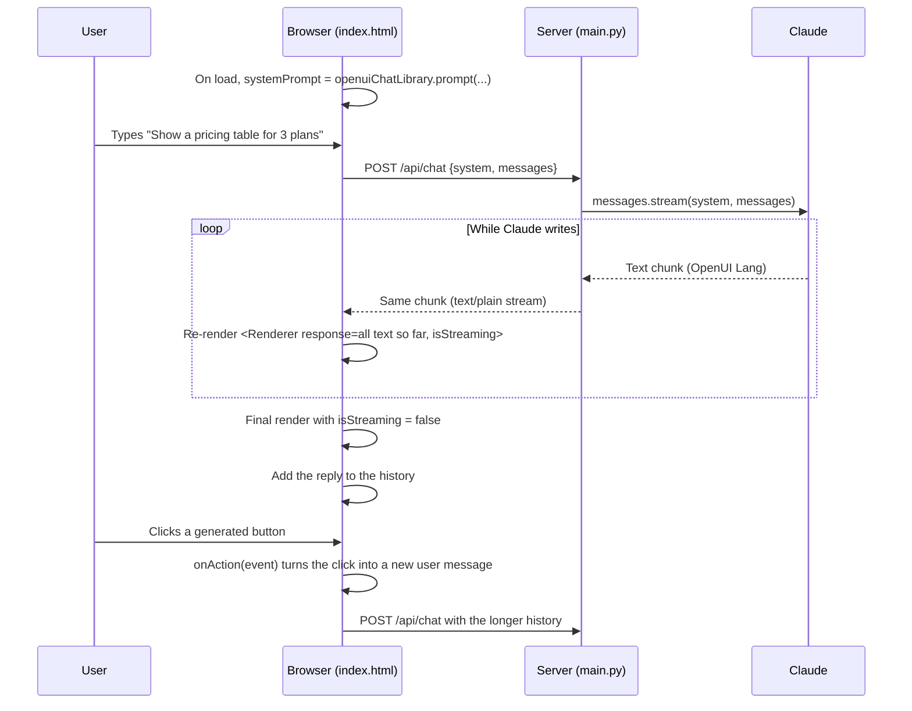
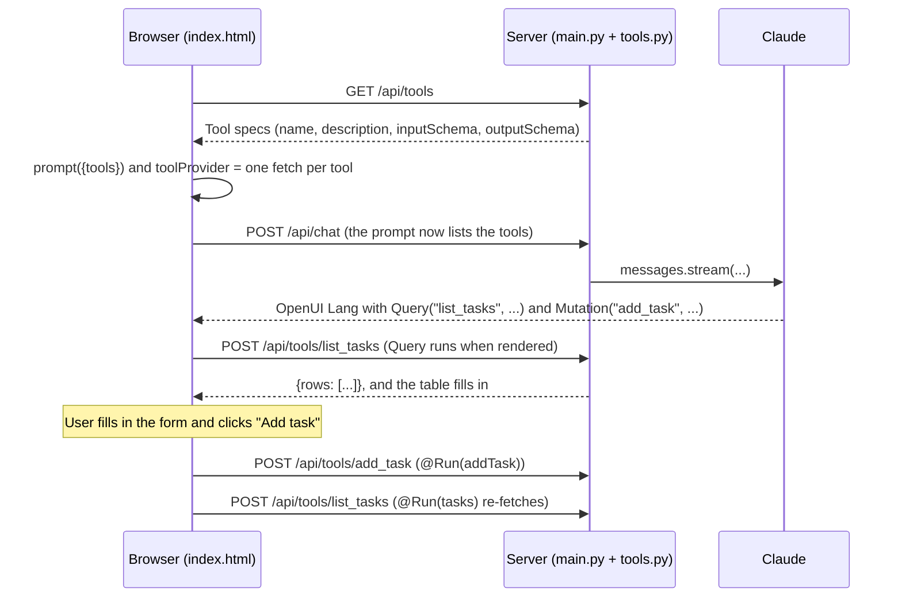

# How the OpenUI flow works

This app is a generative-UI chat. Claude doesn't answer in prose. It answers in
**OpenUI Lang**, a compact language that describes UI components, and the browser turns that
text into live components while it streams in.

There are three parts:

| Part | File | Job |
| --- | --- | --- |
| Browser page | `static/index.html` | Builds the system prompt, sends messages, renders replies, handles clicks |
| Python server | `main.py` | Forwards the conversation to Claude, streams the text back, and runs tools |
| Tools | `tools.py` | Example tools (a task list) that generated UI can read and change |
| Custom components | `static/components.js` | Example components (`Stats`, `Stat`) added to OpenUI's built-in library |
| Claude | `claude-opus-5-5` | Writes the reply in OpenUI Lang |

The renderer and the component library come from OpenUI's prebuilt browser bundle
(`@openuidev/browser-bundle@0.2.1`, loaded from jsDelivr). It exposes one global:

```js
const { React, createRoot, Renderer, openuiChatLibrary } = window.__OpenUI;
```

For one real exchange with the full prompt and response, see [prompt-example.md](prompt-example.md).

## The whole round trip



## Step by step

### 1. The system prompt teaches Claude the components

When the page loads, it asks the component library to describe itself:

```js
const systemPrompt = openuiChatLibrary.prompt({ preamble: "You are a helpful assistant. ..." });
```

The result is about 25 KB of text. It contains:

- The OpenUI Lang syntax rules.
- The signature of every component: `Card`, `CardHeader`, `TextContent`, `Table`, `BarChart`, `Form`, `Button` and so on.
- The available actions, such as `@ToAssistant(...)` and `@OpenUrl(...)`.

The page sends this prompt with every request. That keeps the project free of Node. In a real
app you would generate it once (`npx @openuidev/cli generate ...`) and keep it on the server, so
a client can't change it.

### 2. Claude replies in OpenUI Lang

OpenUI Lang is one statement per line. `root` is the entry point, and every other name must be
used by something, or it won't render:

```text
root = Card([h, t, b])
h = CardHeader("Pro plan", "For growing teams")
t = TextContent("Unlimited projects and 100 GB storage for $19 per month.")
b = Button("Upgrade to Pro", @ToAssistant("Upgrade"))
```

Arguments are positional. Child components are usually defined after the line that uses
them, which lets the renderer draw the outer layout first and fill it in as lines arrive.

### 3. The server streams the text through

`POST /api/chat` takes `{system, messages}` and calls Claude with streaming
(`client.beta.messages.stream`, effort `low` so UI replies come back quickly). Each text chunk is
passed straight to the browser as a plain-text HTTP stream. The server doesn't parse OpenUI
Lang at all.

Two extras:

- **Fallbacks:** `fallbacks="default"` lets Anthropic retry on a substitute model if a safety
  classifier declines the request.
- **Errors:** if something goes wrong (a refusal, a rate limit, an API or connection error),
  the server adds a line starting with `[error]` to the stream instead of failing silently.

### 4. The browser renders while the text arrives

The page reads the response with `fetch` and a stream reader. After every chunk it re-renders
the reply with all the text received so far:

```js
React.createElement(Renderer, {
  response: textSoFar,
  library: openuiChatLibrary,
  isStreaming: true,
  onAction,
});
```

`isStreaming: true` tells the renderer to expect incomplete input, so half-finished lines don't
count as errors. When the stream ends, the page renders once more with `isStreaming: false`.

Lines starting with `[error]` are removed before rendering and shown as a short notice under
the reply.

### 5. The reply joins the conversation history

The finished OpenUI Lang text is stored as the assistant's turn. The next request sends the
whole history, so Claude can see what UI it showed before and change it.

### 6. Clicks become new messages

Generated buttons and forms call `onAction` with an event like this:

```json
{
  "type": "continue_conversation",
  "params": { "context": { "plan": "pro" } },
  "humanFriendlyMessage": "More about Pro",
  "formState": {}
}
```

The page handles it like this:

- **`open_url`** opens the link in a new tab.
- **Anything else** becomes a new user message: the `humanFriendlyMessage`, plus any hidden
  `context` and filled-in form values as JSON. That message goes through the same round trip
  as a typed one.

## Manual mode: no API key needed

Manual mode replaces only step 3, the server calling Claude. Everything else stays the same.

- **When it's on:** the page asks `GET /api/config` whether the server has an
  `ANTHROPIC_API_KEY`, and starts in manual mode if it doesn't. The "Manual mode" button in the
  header switches it, and the choice is saved in the browser.
- **The request:** each message opens a panel with one paste-ready text instead of calling
  `/api/chat`:

  ```text
  <instructions>
  ...the same system prompt as in API mode...
  </instructions>

  <conversation>
  User:
  Show my open tasks as a table with a short summary
  </conversation>

  Reply to the last user message. Output only OpenUI Lang: no prose, no code fences.
  ```

  The system prompt and the conversation go in one text because CLIs and chat apps don't all
  accept a separate system prompt.
- **The reply:** you paste the answer into the panel and click "Render reply".
  - If it contains a fenced code block, only the block's contents are used, since many CLIs wrap
    code.
  - The reply is then rendered and stored in the history exactly like a streamed one.
  - Tools, custom components and buttons all work as usual, because they run in the browser.

Piping the request into a CLI works too, for example
`claude -p --tools "" < request.txt`.

## Tools: live data without asking Claude again

Generated UI can read and change real data through **tools**. Claude writes the calls into
its OpenUI Lang. The browser then runs them directly against the server, so loading data or
saving a form doesn't need another round trip to Claude.

The example tools in `tools.py` manage a small in-memory task list (it resets when the server
restarts):

| Tool | Kind | Does |
| --- | --- | --- |
| `list_tasks(status?)` | read | Returns `{rows: [...]}`, optionally only `open` or `done` tasks |
| `add_task(title, priority?)` | write | Adds an open task and returns `{task: {...}}` |

### How a tool gets from Python to the generated UI



1. **One definition.** Each tool in `tools.py` is a Python function plus a description and
   JSON Schemas for its input and output.
2. **The page learns about the tools.** `GET /api/tools` returns the specs. The page passes
   them to `openuiChatLibrary.prompt({ tools })`, which adds an "Available tools" section to
   the system prompt. That section lists each tool's arguments and result shape, and a default
   value for `Query` results.
3. **Claude writes tool calls.** A reply can now contain lines like these:

   ```text
   tasks = Query("list_tasks", {status: "open"}, {rows: []})
   tbl = Table([Col("Title", tasks.rows.title), Col("Priority", tasks.rows.priority)])
   $title = ""
   addTask = Mutation("add_task", {title: $title, priority: "high"})
   btns = Buttons([Button("Add task", Action([@Run(addTask), @Run(tasks), @Reset($title)]), "primary")])
   ```

   - `Query` reads data and runs as soon as it renders. The third argument is the value shown
     until the result arrives.
   - `Mutation` writes data. It only runs when an action calls `@Run(...)`.
   - `$title` is a variable bound to a form input. `@Reset($title)` clears it again.
4. **The browser runs the calls.** The page passes a `toolProvider` to the Renderer: one async
   function per tool, each of which POSTs its arguments to `/api/tools/<name>`. The server
   calls the Python function and returns its result as JSON. Bad arguments come back as a 400,
   and an unknown tool as a 404.

### Adding your own tool

1. Write a function in `tools.py` that returns JSON-serializable data.
2. Add it to `TOOLS` with a `description`, an `inputSchema` and an `outputSchema`.
3. Restart the server and reload the page. The page picks the tool up from `/api/tools`, so no
   frontend change is needed.

## Components: what Claude can draw

Claude can only use components that are in the **library**, because the library is what
`prompt()` describes to it. This app uses OpenUI's built-in chat library (about 60 components,
such as `Card`, `Table`, `BarChart` and `Form`) extended with its own components in
`static/components.js`.

A component has four parts:

| Part | Purpose |
| --- | --- |
| `name` | What Claude writes in OpenUI Lang, for example `Stat(...)` |
| `description` | Goes in the system prompt and tells Claude when to use it |
| `props` | A Zod schema. Key order is the argument order in OpenUI Lang |
| `component` | A React function that gets `{props, renderNode}` and returns the element |

The example adds two components that use Pearl's `pearl-stat` style:

```js
const Stat = defineComponent({
  name: "Stat",
  description: "A headline number and a short caption saying what it measures. Use inside Stats.",
  props: z.object({ figure: z.string(), caption: z.string() }),
  component: ({ props }) => /* accent figure + muted caption */,
});

const Stats = defineComponent({
  name: "Stats",
  description: "A row of key figures. Lead with these when an answer is about numbers.",
  props: z.object({ items: z.array(Stat.ref) }),   // children must be Stat components
  component: ({ props, renderNode }) => h("div", { className: "stats-row" }, renderNode(props.items)),
});

export const library = openuiChatLibrary.extend({
  components: { add: [{ component: Stats, slots: ["Card.children"] }, Stat] },
});
```

- `Stat.ref` lets another schema accept `Stat` components as children. `renderNode` renders
  those children, including ones that are still streaming in.
- `slots: ["Card.children"]` lets `Stats` appear inside a `Card`. `Stat` is added without a
  slot, so it is only used inside `Stats`.
- `extend` returns a new library and leaves the built-in one unchanged. It can also `override`
  or `remove` built-in components.

The system prompt then lists `Stats(items: Stat[])` and `Stat(figure: string, caption: string)`,
and Claude can write:

```text
stats = Stats([s1, s2])
s1 = Stat("2", "open tasks")
s2 = Stat("67%", "still open")
```

**Why `defineComponent` is replicated:** the browser bundle only exports `React`,
`createRoot`, `Renderer` and `openuiChatLibrary`. So `components.js` loads Zod from jsDelivr at
the version the bundle uses (4.4.3), and defines `defineComponent` the same way OpenUI does
(`{...def, ref: def.props}`). With a build step you would import both from
`@openuidev/react-lang` and `zod` instead.

### Adding your own component

1. Define it in `static/components.js` with `defineComponent`.
2. Add it to the `extend` call. Give it a slot (such as `"Card.children"`) if it should appear
   inside built-in components.
3. Reload the page. The new component is in the system prompt from the next message on.

## Styling and themes

The page and the generated components both use the Pearl design system (`static/pearl/`):

- `tokens.css` defines Pearl's colors, spacing, radii and shadows as CSS variables. It's
  generated from `tokens.json` by `scripts/build_pearl_tokens.py`.
- `openui-pearl.css` points OpenUI's own theme variables (`--openui-*`) at those tokens. It also
  styles OpenUI buttons as Pearl's raised pills.
- **Chart colors** are set by position in `openui-pearl.css`. OpenUI picks chart colors from a
  built-in blue palette in JavaScript, and the browser bundle has no way to change it, so the CSS
  recolors each series instead: `accent`, `accent-ink`, `accent-violet`, `ink-muted`, then two
  softer tints. The first series is always the accent. This covers all nine chart types and
  their legends.
- The theme toggle sets two attributes on `<html>`:
  - `data-theme` (`pearl` or `glass`) switches Pearl's tokens.
  - `data-openui-theme` (`light` or `dark`) switches OpenUI's own defaults.

  The choice is saved in `localStorage`.

## Where to change things

| To change | Edit |
| --- | --- |
| The model, effort or error handling | `main.py` |
| Which tools generated UI can use | `tools.py` |
| Which custom components Claude can use | `static/components.js` |
| What Claude is told about style or tone | The `preamble` in `static/index.html` |
| How clicks are turned into messages | `onAction` in `static/index.html` |
| How generated components look | `static/pearl/openui-pearl.css` |
| Pearl's colors and other tokens | `static/pearl/tokens.json`, then rerun `python scripts/build_pearl_tokens.py` |
