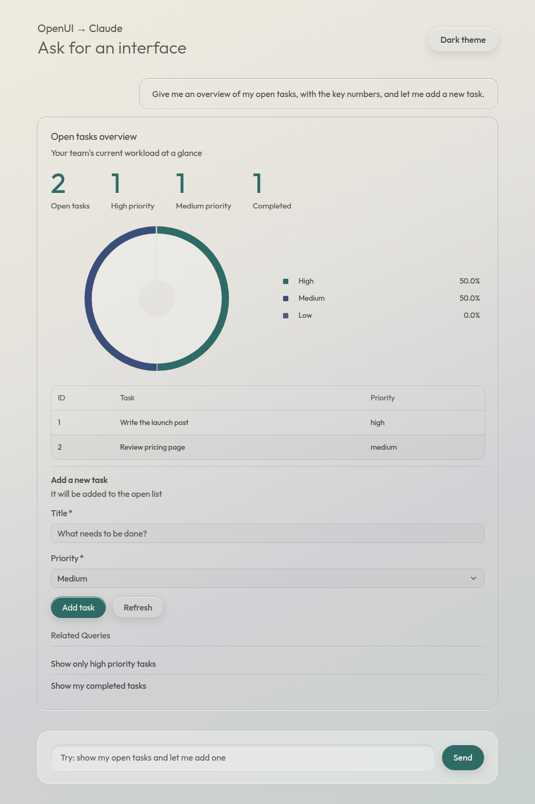

# A full request and response

This is one real exchange with the app, captured on 2026-10-27 with `claude-opus-5-5`. The
complete files are in [`examples/`](examples/):

| File | What it is |
| --- | --- |
| [`system-prompt.txt`](examples/system-prompt.txt) | The exact system prompt the page generated (375 lines) |
| [`request.json`](examples/request.json) | The exact body the page POSTed to `/api/chat` |
| [`response.txt`](examples/response.txt) | Claude's complete reply, as streamed back |
| [`response.png`](examples/response.png) | How that reply rendered |

## 1. The user asks

> Give me an overview of my open tasks, with the key numbers, and let me add a new task.

## 2. The browser sends `POST /api/chat`

The body has two fields: the system prompt and the conversation so far.

```json
{
  "system": "You are a helpful assistant. Answer every message with a rich, interactive UI. ...(37,657 characters)",
  "messages": [
    {
      "role": "user",
      "content": "Give me an overview of my open tasks, with the key numbers, and let me add a new task."
    }
  ]
}
```

### What's in the system prompt

The page builds it with `library.prompt({ preamble, tools })`. It opens with our preamble, then
OpenUI adds these sections:

| Section | Lines | What it teaches Claude |
| --- | --- | --- |
| Preamble | 1 | Our instructions: always answer with UI, sentence case, one primary button |
| Syntax Rules | 3–22 | One `name = Expression` per line, `root` first, positional arguments |
| Component Signatures | 23–174 | Every component and its arguments, grouped (content, tables, charts, forms, ...). Our `Stats` and `Stat` are under "Other" |
| Built-in Functions | 175–202 | `@Count`, `@Filter`, `@Sum` and friends for deriving values |
| Query / Mutation / Action | 203–264 | How to read live data, write data, and wire buttons with `@Run`, `@Set`, `@Reset` |
| Interactive Filters, Forms, Data Workflow | 265–335 | `$variables`, form binding, and when to use live data versus mock data |
| Available Tools | 336–352 | Our two tools from `tools.py`, their arguments, result shapes and `Query` defaults |
| Hoisting & Streaming, Rules, Verification | 353–375 | Write layout first so it streams well, and a final checklist |

For example, our custom components and tools appear like this:

```text
Stats(items: Stat[]) — A row of key figures. Lead with these when an answer is about numbers.
Stat(figure: string, caption: string) — A headline number and a short caption saying what it measures. Use inside Stats.
...
- list_tasks(status?: "open" | "done") → {rows?: {id?: number, title?: string, priority?: "low" | "medium" | "high", status?: "open" | "done"}[]}
  List tasks in the team's task list, optionally filtered by status.
- add_task(title: string, priority?: "low" | "medium" | "high") → {task?: {...}}
  Add an open task to the task list.
```

## 3. The server calls Claude

`main.py` turns the body into one streaming Messages API call:

```python
client.beta.messages.stream(
    model="claude-opus-5-5",
    max_tokens=64000,
    system=req.system,                      # the 37 KB prompt above
    messages=[...],                         # the history above
    output_config={"effort": "low"},
    betas=["server-side-fallback-2026-07-01"],
    fallbacks="default",
)
```

Each text chunk is passed straight through to the browser. For this request the first chunk
arrived after 1.7 seconds and the whole reply after 9.1 seconds.

## 4. Claude's response

This is the complete reply (2,397 characters), unedited:

```text
root = Card([header, stats, priorityChart, tasksTable, sep, addHeader, addForm, statusMsg, followUps])

$title = ""
$priority = "medium"

openTasks = Query("list_tasks", {status: "open"}, {rows: []})
doneTasks = Query("list_tasks", {status: "done"}, {rows: []})
addResult = Mutation("add_task", {title: $title, priority: $priority})

header = CardHeader("Open tasks overview", "Your team's current workload at a glance")

stats = Stats([statOpen, statHigh, statMedium, statDone])
statOpen = Stat("" + @Count(openTasks.rows), "Open tasks")
statHigh = Stat("" + @Count(@Filter(openTasks.rows, "priority", "==", "high")), "High priority")
statMedium = Stat("" + @Count(@Filter(openTasks.rows, "priority", "==", "medium")), "Medium priority")
statDone = Stat("" + @Count(doneTasks.rows), "Completed")

priorityChart = PieChart(["High", "Medium", "Low"], [@Count(@Filter(openTasks.rows, "priority", "==", "high")), @Count(@Filter(openTasks.rows, "priority", "==", "medium")), @Count(@Filter(openTasks.rows, "priority", "==", "low"))], "donut")

tasksTable = Table([colId, colTitle, colPriority])
colId = Col("ID", openTasks.rows.id, "number")
colTitle = Col("Task", openTasks.rows.title)
colPriority = Col("Priority", openTasks.rows.priority)

sep = Separator()

addHeader = InlineHeader("Add a new task", "It will be added to the open list")
addForm = Form("addTask", addButtons, [titleField, priorityField])
titleField = FormControl("Title", Input("title", "What needs to be done?", "text", {required: true, minLength: 3, maxLength: 120}, $title))
priorityField = FormControl("Priority", Select("priority", [SelectItem("low", "Low"), SelectItem("medium", "Medium"), SelectItem("high", "High")], null, {required: true}, $priority))
addButtons = Buttons([addBtn, refreshBtn])
addBtn = Button("Add task", Action([@Run(addResult), @Run(openTasks), @Reset($title, $priority)]), "primary")
refreshBtn = Button("Refresh", Action([@Run(openTasks), @Run(doneTasks)]), "secondary")

statusMsg = addResult.status == "loading" ? TextContent("Adding task...", "small") : addResult.status == "success" ? Callout("success", "Task added", "Your new task is now in the open list.") : addResult.status == "error" ? Callout("error", "Couldn't add task", "" + addResult.error) : null

followUps = FollowUpBlock([fu1, fu2])
fu1 = FollowUpItem("Show only high priority tasks")
fu2 = FollowUpItem("Show my completed tasks")
```

### Reading it

- **Layout first.** `root` lists the whole card on the first line, so the renderer can lay
  out the frame before the details arrive.
- **State.** `$title` and `$priority` are variables bound to the form inputs.
- **Live data.** Two `Query` calls read open and done tasks through `list_tasks`. The third
  argument, `{rows: []}`, is shown until the result arrives.
- **Write.** `addResult` is a `Mutation` on `add_task`. It doesn't run until a button runs it.
- **Custom components.** `Stats` and `Stat` come from `static/components.js`. Claude followed
  their descriptions and led with key numbers.
- **Derived values.** The figures and the donut chart are computed in the browser with
  `@Count` and `@Filter` over the query results. Claude never sees the actual tasks.
- **Buttons.**
  - "Add task" runs the mutation, re-fetches the open tasks and clears the form.
  - "Refresh" re-fetches both queries.
  - There is one primary button, as the preamble asked.
- **Feedback.** `statusMsg` switches on `addResult.status` to show a loading line, a success
  callout or an error callout.
- **Follow-ups.** `FollowUpItem`s are suggested next questions. Clicking one sends it as a new
  message.

## 5. The browser renders it and runs the tools

While the text streams in, the page re-renders it after every chunk. As soon as the `Query`
lines are complete, the renderer calls the `toolProvider`, which makes these requests:

```text
POST /api/tools/list_tasks   {"status": "open"}   →  {"rows": [{"id": 1, ...}, {"id": 2, ...}]}
POST /api/tools/list_tasks   {"status": "done"}   →  {"rows": [{"id": 3, ...}]}
```

These calls go from the browser to our server only. Claude isn't involved. The result:



## 6. The next turn

When the stream ends, the page stores the reply as the assistant's turn. The next request
sends the whole history:

```json
{
  "system": "...same prompt...",
  "messages": [
    { "role": "user", "content": "Give me an overview of my open tasks, with the key numbers, and let me add a new task." },
    { "role": "assistant", "content": "root = Card([header, stats, ...])\n..." },
    { "role": "user", "content": "Show only high priority tasks" }
  ]
}
```

Claude sees its earlier OpenUI Lang, so it can adjust that UI rather than start over. It never
sees the live task data: the tools return it straight to the browser.
